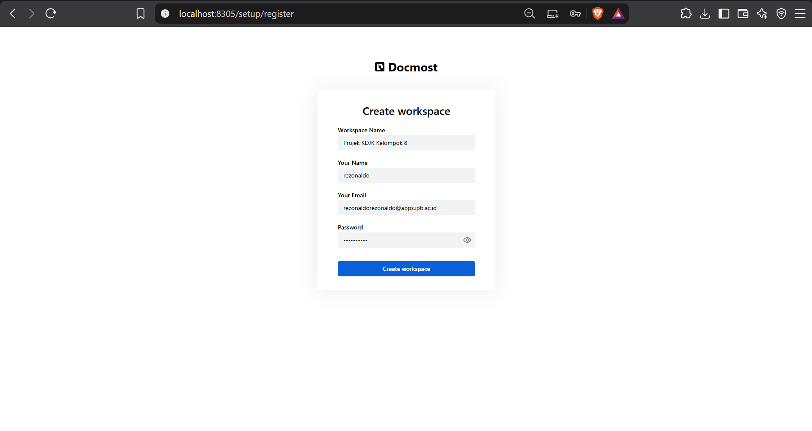
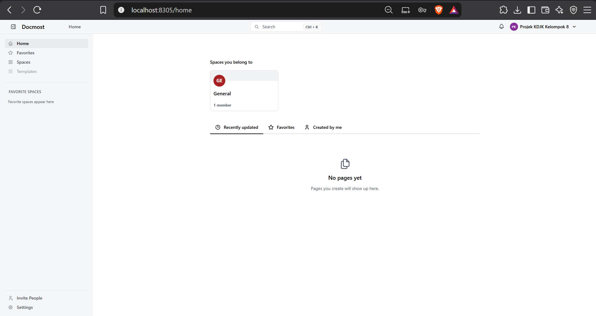
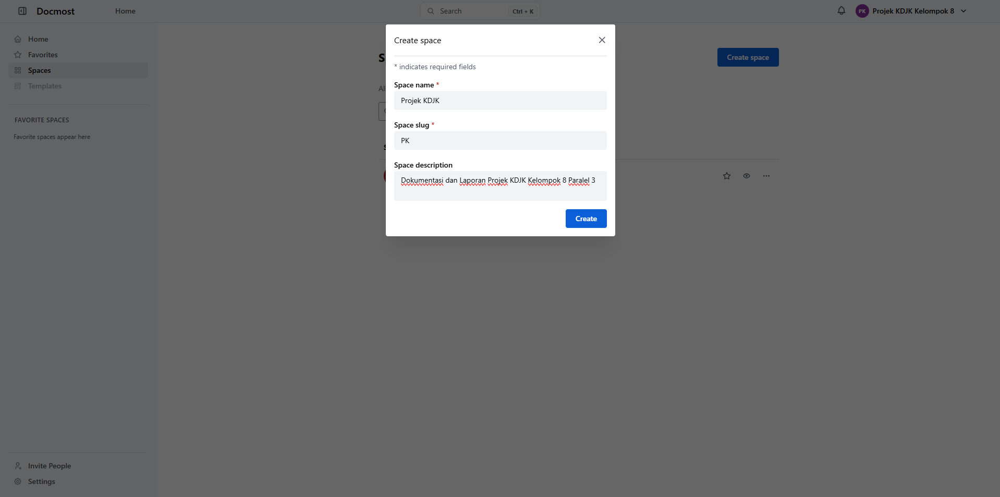
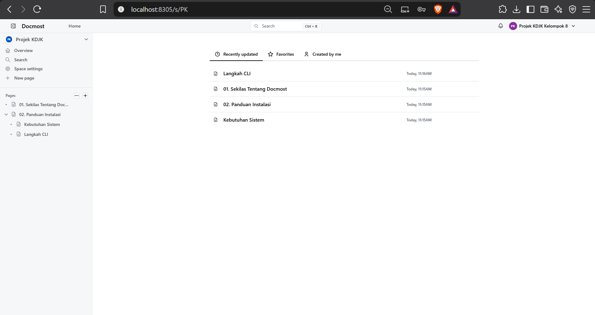
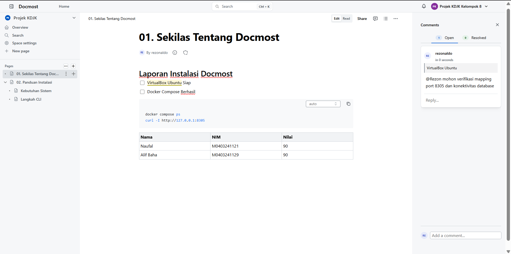
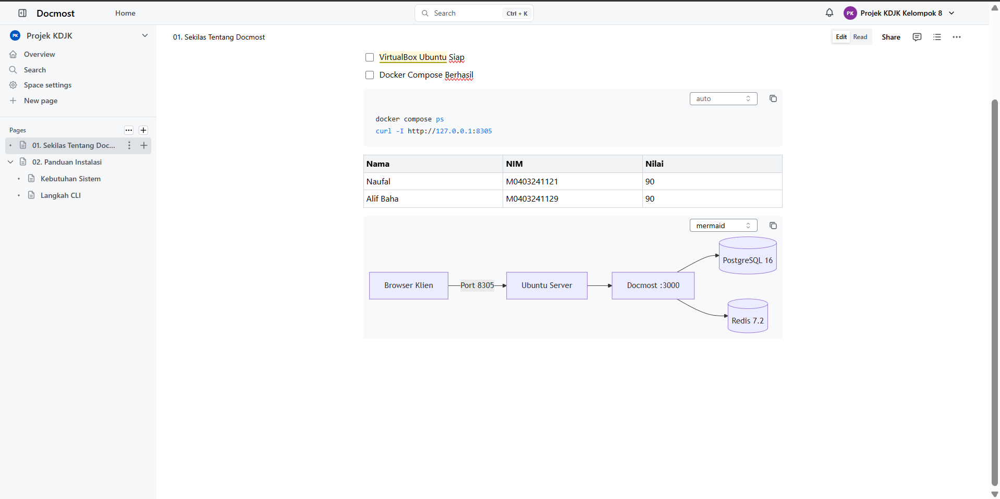
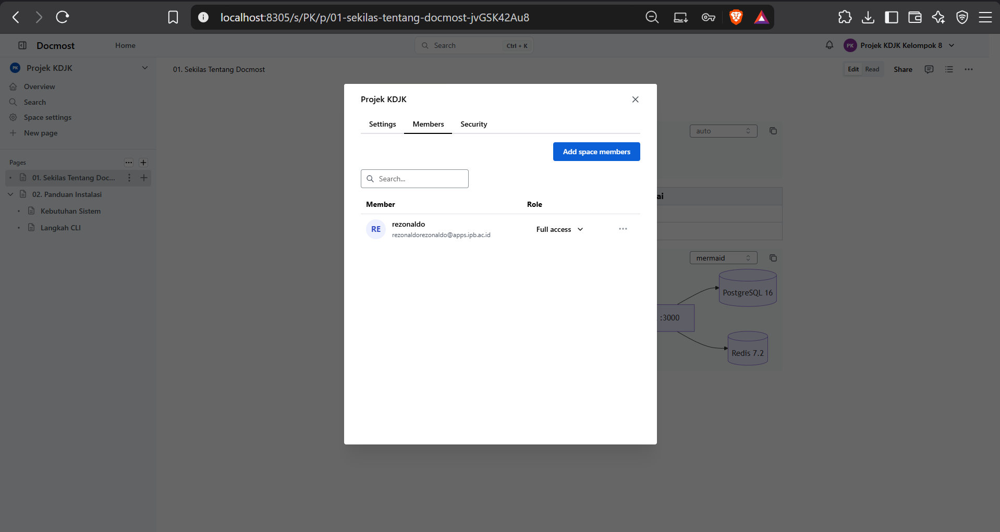

<p align="center">
  
</p>

<h1 align="center">Docmost</h1>

<p align="center">
  <b>Collaborative Wiki and Documentation Software</b><br>
  <i>Laporan Projek Akhir Mata Kuliah Komunikasi Data dan Jaringan Komputer (KDJK)</i><br>
  <b>Kelompok 8 Paralel 3</b>
</p>

[Sekilas Tentang](#sekilas-tentang) | [Instalasi](#instalasi) | [Konfigurasi](#konfigurasi) | [Maintenance](#maintenance) | [Otomatisasi](#otomatisasi) | [Cara Pemakaian](#cara-pemakaian) | [Pembahasan](#pembahasan) | [Referensi](#referensi)
:---:|:---:|:---:|:---:|:---:|:---:|:---:

---

# Sekilas Tentang
[`^kembali`](#)

**Docmost** adalah aplikasi web *open-source* yang dirancang sebagai platform wiki dan manajemen dokumentasi kolaboratif (*knowledge base*). Aplikasi ini memungkinkan beberapa pengguna untuk menyunting dokumen secara bersamaan (*real-time collaboration*), sehingga sangat ideal digunakan untuk dokumentasi teknis, catatan arsitektur sistem, basis pengetahuan tim, panduan proyek, serta dokumentasi operasional organisasi.

Docmost hadir sebagai alternatif mandiri (*self-hosted*) untuk platform populer seperti **Notion** dan **Confluence**. Dengan arsitektur modern berbasis web, Docmost memberikan kendali penuh kepada pengelola atas kedaulatan data (*data privacy*), infrastruktur komputasi, serta keamanan jaringan internal tanpa ketergantungan pada vendor pihak ketiga (*vendor lock-in*).

Komponen inti dari Docmost didistribusikan di bawah lisensi terbuka **AGPL-3.0**. Arsitektur layanannya dibangun di atas teknologi kontemporer:
- **Frontend / Client**: Single Page Application (SPA) responsif yang mendukung editor dokumen WYSIWYG/Markdown secara interaktif.
- **Backend / Core Service**: Menangani *real-time synchronization*, logika autentikasi, API workspace, dan penanganan dokumen.
- **Database Engine**: Didukung oleh **PostgreSQL 16** sebagai basis data relasional utama untuk integritas data terstruktur.
- **In-Memory Cache & Message Broker**: Didukung oleh **Redis 7.2** untuk caching, manajemen antrean, dan pub/sub sinkronisasi kolaborasi *real-time*.

Dalam konteks mata kuliah **Komunikasi Data dan Jaringan Komputer (KDJK)**, Docmost diimplementasikan pada lingkungan Virtual Machine (VM) Ubuntu Server menggunakan orkestrasi **Docker Compose**. Proyek ini mendemonstrasikan integrasi jaringan kontainer (*bridge network*), pemetaan *port forwarding* (Host port `8305` ke Container port `3000`), pengelolaan volume persisten, serta penerapan reverse proxy untuk akses domain publik `docmost.ultradot.space`.

<p align="center">
  
  <br>
  <i>Gambar 1. Antarmuka dashboard utama Docmost berbasis spaces dan hierarki halaman.</i>
</p>

---

# Instalasi
[`^kembali`](#)

Instalasi Docmost dilakukan dengan pendekatan kontainerisasi menggunakan Docker Compose di lingkungan Ubuntu Server. Pendekatan ini menjamin isolasi antarlayanan, kemudahan replikasi, dan efisiensi alokasi sumber daya jaringan serta komputasi.

#### Kebutuhan Sistem :
- **Sistem Operasi**: Ubuntu Server 22.04 LTS / 24.04 LTS (atau Virtual Machine / VPS NCC).
- **Runtime Kontainer**: Docker Engine v24.0+ dan Docker Compose Plugin v2.20+.
- **Alokasi Memori (RAM)**: Minimal 2 GB (Rekomendasi 4 GB untuk menampung Docmost, PostgreSQL, dan Redis).
- **Ruang Penyimpanan (Disk)**: Minimal 10 GB ruang kosong untuk image kontainer dan volume data.
- **Konektivitas Jaringan**: Akses internet untuk pengunduhan image kontainer dari Docker Hub dan port `8305` terbuka pada firewall host.
- **Utilitas Pendukung**: `openssl`, `curl`, dan `ca-certificates`.

---

#### Proses Instalasi :

1. **Akses ke Ubuntu Server via SSH**  
   Buka terminal lokal dan lakukan koneksi aman ke Ubuntu Server tujuan:
   ```bash
   ssh <username>@<IP_VM> -p 22
   ```
   > *Sesuaikan `<username>` dan `<IP_VM>` dengan akun dan alamat IP VM kamu (misal: `adam@172.18.88.78` jika menggunakan VPS NCC).*

2. **Pembaruan Paket Sistem dan Dependensi Docker**  
   Pastikan repositori sistem mutakhir dan komponen kontainer terpasang:
   ```bash
   sudo apt-get update && sudo apt-get upgrade -y
   sudo apt-get install -y ca-certificates curl gnupg openssl
   ```
   Jika Docker belum terpasang, instal Docker Engine resmi melalui repository Docker:
   ```bash
   sudo install -m 0755 -d /etc/apt/keyrings
   curl -fsSL https://download.docker.com/linux/ubuntu/gpg | sudo gpg --dearmor -o /etc/apt/keyrings/docker.gpg
   sudo chmod a+r /etc/apt/keyrings/docker.gpg

   echo \
     "deb [arch=$(dpkg --print-architecture) signed-by=/etc/apt/keyrings/docker.gpg] https://download.docker.com/linux/ubuntu \
     $(. /etc/os-release && echo "$VERSION_CODENAME") stable" | \
     sudo tee /etc/apt/sources.list.d/docker.list > /dev/null

   sudo apt-get update
   sudo apt-get install -y docker-ce docker-ce-cli containerd.io docker-compose-plugin
   ```
   Verifikasi kesiapan Docker:
   ```bash
   docker --version
   docker compose version
   ```

3. **Menyiapkan Direktori Kerja Khusus**  
   Buat folder kerja untuk menyimpan konfigurasi dan volume stack Docmost:
   ```bash
   mkdir -p ~/docmost
   cd ~/docmost
   ```

4. **Menghasilkan Encryption Secret Key**  
   Docmost memerlukan kunci kriptografi acak berpanjang 32-byte (hexadecimal) untuk enkripsi sesi, cookie, dan token keamanan JWT:
   ```bash
   openssl rand -hex 32
   ```
   *Salin hasil output hexadecimal tersebut untuk disematkan pada parameter `APP_SECRET`.*

5. **Membuat Berkas Konfigurasi `docker-compose.yml`**  
   Susun berkas konfigurasi layanan menggunakan teks editor `nano`:
   ```bash
   nano docker-compose.yml
   ```
   Masukkan definisi stack multi-container berikut:
   ```yaml
   services:
     docmost:
       image: docmost/docmost:latest
       depends_on:
         - db
         - redis
       environment:
         APP_URL: "http://localhost:8305"
         APP_SECRET: "<hex_secret_dari_langkah_4>"
         DATABASE_URL: "postgresql://docmost:DocmostSecurePass2024!@db:5432/docmost?schema=public"
         REDIS_URL: "redis://redis:6379"
       ports:
         - "8305:3000"   # Meneruskan port host 8305 ke port internal container 3000
       restart: unless-stopped
       volumes:
         - docmost_storage:/app/data/storage

     db:
       image: postgres:16-alpine
       environment:
         POSTGRES_DB: docmost
         POSTGRES_USER: docmost
         POSTGRES_PASSWORD: "DocmostSecurePass2024!"
       restart: unless-stopped
       volumes:
         - db_data:/var/lib/postgresql/data

     redis:
       image: redis:7.2-alpine
       command: ["redis-server", "--appendonly", "yes", "--maxmemory-policy", "noeviction"]
       restart: unless-stopped
       volumes:
         - redis_data:/data

   volumes:
     docmost_storage:
     db_data:
     redis_data:
   ```
   > **Catatan Keamanan:** Ganti `<hex_secret_dari_langkah_4>` dengan secret acak hasil OpenSSL, serta pastikan kata sandi basis data pada `DATABASE_URL` identik dengan `POSTGRES_PASSWORD`.

6. **Menjalankan Seluruh Layanan Kontainer**  
   Eksekusi perintah Docker Compose untuk mengunduh image, membangun network internal, dan menjalankan kontainer di latar belakang:
   ```bash
   docker compose up -d
   ```

7. **Verifikasi Status Kontainer dan Healthcheck**  
   Pastikan ketiga kontainer (`docmost`, `db`, dan `redis`) berstatus `Up` / `running`:
   ```bash
   docker compose ps
   ```
   Lakukan pengujian respon HTTP pada endpoint lokal:
   ```bash
   curl -I http://127.0.0.1:8305
   ```
   Jika terminal menampilkan respon `HTTP/1.1 200 OK` (atau `HTTP/1.1 302 Found` yang mengarahkan ke setup/login), layanan Docmost telah berhasil beroperasi dan siap digunakan.

8. **Akses Antarmuka Web Docmost**  
   Buka peramban (*web browser*) dari komputer klien dan akses:
   - Akses Port Lokal Host: `http://IP_VM:8305` (atau `http://localhost:8305` jika diakses langsung dari server).
   - Akses Domain Publik (jika reverse proxy aktif): `https://docmost.ultradot.space`

---

#### Pengujian Instalasi :

Berikut adalah rekapitulasi pengujian tahap instalasi yang dilakukan pada lingkungan server:

| No. | Parameter Pengujian | Perintah / Metode | Ekspektasi Hasil | Status Aktual |
|:---:|:---|:---|:---|:---:|
| 1 | Pengecekan Service Docker | `sudo systemctl status docker` | Layanan berstatus `active (running)` | **Berhasil** |
| 2 | Status Kontainer Stack | `docker compose ps` | Ketiga kontainer berstatus `Up` | **Berhasil** |
| 3 | Konektivitas Database | Log `docker compose logs db` | PostgreSQL siap menerima koneksi port 5432 | **Berhasil** |
| 4 | Konektivitas Redis | Log `docker compose logs redis` | Redis siap menerima koneksi port 6379 | **Berhasil** |
| 5 | HTTP Response Endpoint | `curl -I http://127.0.0.1:8305` | Respon `HTTP/1.1 200 OK` | **Berhasil** |
| 6 | Akses Web GUI Browser | Membuka `http://IP_VM:8305` | Tampil halaman inisialisasi / login | **Berhasil** |

---

# Konfigurasi
[`^kembali`](#)

Konfigurasi aplikasi Docmost berfokus pada penyesuaian lingkungan jaringan, manajemen data persisten, serta integrasi lapisan keamanan antarmuka.

### 1. Konfigurasi Environment Variable
Pengaturan inti Docmost dikelola melalui berkas `docker-compose.yml`:
- **`APP_URL`**: Mendefinisikan URL resmi yang dikenali oleh aplikasi untuk pembuatan pranala, aset statis, dan validasi *origin header*. Jika diakses langsung via IP, gunakan format `http://IP_VM:8305`. Jika menggunakan reverse proxy berdomain HTTPS, ubah nilainya menjadi `https://docmost.ultradot.space`.
- **`APP_SECRET`**: Kunci enkripsi simetris 256-bit untuk mengamankan tanda tangan token otentikasi.
- **`DATABASE_URL`**: Format connection string standar PostgreSQL: `postgresql://<user>:<password>@<service-name>:<port>/<db_name>?schema=public`. Menggunakan nama service Compose `db` sebagai resolver DNS internal Docker.
- **`REDIS_URL`**: Menyambungkan aplikasi ke container Redis pada port standar `6379`.

### 2. Konfigurasi Port Forwarding dan Jaringan Kontainer
Docmost secara internal berjalan pada port `3000`. Pada level host Ubuntu Server, port `8305` dipilih sebagai port masukan (*incoming port*):
```yaml
ports:
  - "8305:3000"
```
Mekanisme ini memanfaatkan iptables dan routing Docker Bridge network sehingga paket TCP dari antarmuka fisik server pada port 8305 diteruskan ke port 3000 di dalam kontainer Docmost.

### 3. Konfigurasi Basis Data PostgreSQL
PostgreSQL 16 dijalankan dengan parameter khusus untuk performa dokumen:
- Database dan username default diinisialisasi secara otomatis saat volume pertama kali dibuat.
- Menggunakan volume Docker `db_data` yang dipetakan ke `/var/lib/postgresql/data`. Hal ini menjamin bahwa seluruh skema, tabel, akun, dan konten halaman tersimpan permanen di storage host dan tidak hilang saat container diperbarui.

### 4. Konfigurasi Redis In-Memory Cache
Redis 7.2 dikonfigurasi melalui argumen perintah kontainer:
```bash
["redis-server", "--appendonly", "yes", "--maxmemory-policy", "noeviction"]
```
- `--appendonly yes`: Mengaktifkan mekanisme Append Only File (AOF) untuk menjamin persistensi log transaksi Redis ke disk, mencegah kehilangan data *state* kolaborasi saat server mendadak restart.
- `--maxmemory-policy noeviction`: Mencegah Redis menghapus data kunci sesi aktif jika memori mendekati batas ambang batas.

### 5. Konfigurasi Penyimpanan Berkas (*Persistent Storage*)
Volume `docmost_storage` dipetakan ke direktori internal kontainer `/app/data/storage`. Direktori ini menyimpan:
- Berkas avatar pengguna dan logo workspace.
- Gambar dan lampiran file PDF/ZIP yang diunggah ke dalam halaman dokumentasi.
- Aset ekspor data dokumen.

### 6. Konfigurasi Reverse Proxy & Domain Publik (Opsional)
Untuk menghubungkan domain `docmost.ultradot.space` secara aman menggunakan HTTPS (SSL Let's Encrypt), web server Caddy atau Nginx dikonfigurasikan di depan port `8305`.

**Contoh Konfigurasi Caddy (`Caddyfile`):**
```caddy
docmost.ultradot.space {
    reverse_proxy 127.0.0.1:8305
}
```

**Contoh Konfigurasi Nginx (`/etc/nginx/sites-available/docmost`):**
```nginx
server {
    server_name docmost.ultradot.space;

    location / {
        proxy_pass http://127.0.0.1:8305;
        proxy_http_version 1.1;
        proxy_set_header Upgrade $http_upgrade;
        proxy_set_header Connection "upgrade";
        proxy_set_header Host $host;
        proxy_set_header X-Real-IP $remote_addr;
        proxy_set_header X-Forwarded-For $proxy_add_x_forwarded_for;
        proxy_set_header X-Forwarded-Proto $scheme;
    }
}
```

---

# Maintenance
[`^kembali`](#)

Pemeliharaan sistem secara berkala wajib dilakukan untuk menjaga integritas data, ketersediaan layanan (*high availability*), dan keandalan operasional aplikasi Docmost.

### 1. Pencadangan (*Backup*) Basis Data PostgreSQL
Pencadangan logis dilakukan menggunakan utilitas `pg_dump` langsung dari dalam container database tanpa perlu menghentikan layanan:
```bash
cd ~/docmost

# Menghasilkan file SQL backup berstempel waktu
docker compose exec -T db pg_dump -U docmost docmost > backup_docmost_$(date +%Y%m%d_%H%M%S).sql
```

### 2. Pencadangan Volume File & Lampiran
Selain basis data, direktori penyimpanan dokumen (`docmost_storage`) perlu dicadangkan secara periodik:
```bash
# Backup arsip storage dokumen ke file terkompresi
docker run --rm -v docmost_docmost_storage:/storage -v $(pwd):/backup alpine \
  tar -czf /backup/docmost_storage_$(date +%Y%m%d).tar.gz -C /storage .
```

### 3. Pemulihan (*Restore*) Data
Jika terjadi insiden kehilangan data atau migrasi server:
- **Restore Database**:
  ```bash
  cat backup_docmost_YYYYMMDD.sql | docker compose exec -T db psql -U docmost -d docmost
  ```
- **Restore File Storage**:
  ```bash
  docker run --rm -v docmost_docmost_storage:/storage -v $(pwd):/backup alpine \
    tar -xzf /backup/docmost_storage_YYYYMMDD.tar.gz -C /storage
  ```

### 4. Pembaruan Versi Kontainer (*Upgrade Image*)
Untuk memperbarui Docmost ke rilis versi terbaru:
```bash
cd ~/docmost
docker compose pull
docker compose up -d --remove-orphans
```

### 5. Pemantauan Log dan Kinerja Kontainer
Pemeriksaan log dilakukan secara *real-time* untuk mendeteksi *error* aplikasi atau koneksi:
```bash
# Pantau log aplikasi Docmost
docker compose logs -f docmost

# Pantau konsumsi CPU dan RAM kontainer
docker stats
```

---

# Otomatisasi
[`^kembali`](#)

Untuk mempermudah proses deployment, konfigurasi, dan pemeliharaan server, kelompok kami telah menyediakan skrip otomatisasi bash yang dapat dieksekusi dalam satu langkah.

### 1. Skrip Instalasi Otomatis (`setup.sh`)
Skrip [setup.sh](setup.sh) disediakan langsung di dalam repositori ini. Skrip ini secara otomatis:
- Memeriksa dan menginstal paket Docker & Docker Compose Plugin.
- Membuat direktori kerja di `~/docmost`.
- Menghasilkan `APP_SECRET` unik dan password acak basis data.
- Menulis berkas konfigurasi `docker-compose.yml`.
- Menjalankan kontainer di latar belakang dan memverifikasi respon HTTP port 8305.

Cara menjalankan skrip:
```bash
chmod +x setup.sh
./setup.sh
```

### 2. Otomatisasi Startup Layanan via Systemd
Agar kontainer Docker otomatis dijalankan saat sistem Ubuntu Server melakukan *booting* atau *reboot*:
```bash
# Aktifkan service daemon Docker agar berjalan otomatis saat boot
sudo systemctl enable --now docker
```
Ditambah dengan deklarasi `restart: unless-stopped` pada setiap layanan di `docker-compose.yml`, Docker daemon akan secara otomatis membangkitkan kembali kontainer Docmost, PostgreSQL, dan Redis tanpa memerlukan intervensi manual dari administrator.

### 3. Otomatisasi Backup Terjadwal via Crontab
Untuk menjamin pencadangan data otomatis setiap tengah malam (pukul 02:00 WIB), tambahkan entri pada cron daemon:
```bash
crontab -e
```
Tambahkan baris berikut:
```cron
0 2 * * * cd ~/docmost && docker compose exec -T db pg_dump -U docmost docmost > ~/backups/docmost_$(date +\%F).sql
```

---

# Cara Pemakaian
[`^kembali`](#)

Docmost menyediakan antarmuka web modern, elegan, dan intuitif. Berikut adalah panduan langkah-demi-langkah pengoperasian aplikasi untuk kebutuhan kolaborasi tim:

### 1. Inisialisasi Akun Administrator dan Workspace
Saat pertama kali mengakses `http://IP_VM:8305`, pengguna akan diarahkan ke halaman konfigurasi awal:
1. Masukkan **Nama Workspace** (misalnya: `Projek Akhir KDJK Kelompok 8`).
2. Masukkan identitas pengguna administrator (Nama Lengkap, Email, dan Password yang kuat).
3. Klik tombol **Create Workspace**. Akun ini akan bertindak sebagai pemilik (*Workspace Owner*).

<p align="center">
  
  <br>
  <i>Gambar 2. Halaman konfigurasi awal dan registrasi akun pemilik workspace.</i>
</p>

---

### 2. Navigasi Dashboard Utama
Setelah otentikasi berhasil, pengguna disambut oleh antarmuka dashboard utama yang menyajikan daftar space, dokumen terkini, dan panel navigasi samping (*sidebar*).

<p align="center">
  
  <br>
  <i>Gambar 3. Tampilan dashboard utama Docmost setelah login.</i>
</p>

---

### 3. Membuat Space (Ruang Kerja Proyek)
Spaces digunakan untuk mengisolasi topik atau subproyek tertentu agar dokumentasi tidak tercampur:
1. Klik tombol **New Space** pada panel samping kiri.
2. Masukkan nama space, misalnya: `Projek Akhir KDJK`.
3. Tentukan deskripsi dan visibilitas ruang kerja (Public atau Restricted).
4. Klik **Create**.

<p align="center">
  
  <br>
  <i>Gambar 4. Dialog pembuatan Space untuk pengelompokan dokumentasi proyek.</i>
</p>

---

### 4. Membuat Struktur Halaman dan Subhalaman Bertingkat
Docmost mendukung struktur hierarki bertingkat (*nested documentation structure*):
1. Pilih space yang aktif, lalu klik tombol **New Page** (`+`).
2. Tuliskan judul halaman utama, misalnya `Laporan Instalasi Docmost`.
3. Untuk membuat subhalaman, klik ikon titik tiga (`...`) atau ikon tambah pada halaman induk di sidebar.

Contoh struktur pengorganisasian dokumen kelompok:
```text
Projek Akhir KDJK (Space)
├── 01. Sekilas Tentang Docmost
├── 02. Panduan Instalasi
│   ├── Kebutuhan Sistem
│   └── Langkah-langkah CLI
├── 03. Konfigurasi Jaringan & Port
├── 04. Prosedur Maintenance
├── 05. Hasil Pengujian & Evaluasi
└── 06. Perbandingan Aplikasi (Notion & BookStack)
```

<p align="center">
  
  <br>
  <i>Gambar 5. Panel sidebar dengan navigasi halaman dan subhalaman bertingkat.</i>
</p>

---

### 5. Menyunting Konten dengan Editor Kaya (*Rich-Text & Markdown*)
Docmost mengusung editor konten modern yang mendukung pemformatan instan:
- **Headings**: `#` untuk Judul Utama (H1), `##` untuk H2, dan `###` untuk H3.
- **Blok Kode (Code Block)**: Mendukung *syntax highlighting* untuk Bash, YAML, SQL, Python, JavaScript, dll.
- **Tabel & Checklist**: Pembuatan tabel data rapi serta daftar tugas interaktif.
- **Media**: Unggah gambar dokumen melalui mekanisme *drag-and-drop*.

<p align="center">
  
  <br>
  <i>Gambar 6. Tampilan editor dokumen Docmost dengan dukungan format konten multimedia.</i>
</p>

---

### 6. Kolaborasi Real-Time, Komentar, dan Mention Anggota
- **Real-Time Co-Authoring**: Beberapa anggota kelompok dapat mengetik dan menyunting dokumen yang sama secara bersamaan tanpa saling menimpa (*conflict-free*).
- **Inline Comment**: Sorot teks tertentu dan tambahkan komentar diskusi.
- **User Mention**: Ketik `@nama_anggota` untuk mengirimkan notifikasi langsung terkait bagian dokumen yang memerlukan verifikasi.

<p align="center">
  
  <br>
  <i>Gambar 7. Diskusi kolaboratif menggunakan komentar dan penandaan anggota tim.</i>
</p>

---

### 7. Pembuatan Diagram Interaktif (Mermaid & Excalidraw)
Docmost secara bawaan mengintegrasikan generator diagram grafis:
- **Mermaid.js**: Diagram alur (*flowchart*), diagram sekuensial, dan topologi jaringan dapat ditulis langsung dalam bentuk teks kode.
- **Excalidraw / Draw.io**: Sketsa arsitektur interaktif langsung dari dalam halaman dokumentasi.

<p align="center">
  
  <br>
  <i>Gambar 8. Integrasi pembuatan diagram arsitektur interaktif di halaman dokumen.</i>
</p>

---

### 8. Manajemen Pengguna dan Hak Akses (*Permissions*)
Administrator dapat mengundang anggota kelompok dan menetapkan wewenang:
- **Admin**: Akses penuh ke seluruh konfigurasi workspace, integrasi, dan billing.
- **Member**: Dapat membuat, menyunting, dan membaca halaman pada space yang diizinkan.
- **Viewer**: Hanya memiliki izin membaca (*read-only*), cocok untuk penilaian atau pengujian eksternal.

<p align="center">
  
  <br>
  <i>Gambar 9. Menu manajemen keanggotaan dan pengaturan hak akses tim.</i>
</p>

---

# Pembahasan
[`^kembali`](#)

### 1. Tinjauan Arsitektur Jaringan (Perspektif KDJK)
Penerapan Docmost merefleksikan konsep-konsep fundamental dalam komunikasi data dan jaringan komputer:
- **Port Mapping & Network Address Translation (NAT)**: Paket TCP yang tiba pada alamat IP Host port `8305` diterjemahkan oleh subnet Docker Bridge ke port kontainer `3000`.
- **Inter-Container Communication (Service Discovery)**: Kontainer aplikasi berkomunikasi dengan PostgreSQL (`db:5432`) dan Redis (`redis:6379`) memanfaatkan internal DNS resolver Docker Compose tanpa mengekspos port database ke jaringan publik.
- **Real-Time Data Streaming via WebSockets**: Mekanisme kolaborasi *real-time* memanfaatkan koneksi *full-duplex* WebSocket antara browser klien dan Docmost backend.

```mermaid
flowchart LR
    subgraph Klien["Perangkat Klien (Kolega / Penilai)"]
        Browser["Web Browser\n(HTTP/WebSocket)"]
    end

    subgraph HostServer["Ubuntu Server (Host VM)"]
        PortHost["Port Forwarding\nHost :8305"]
        
        subgraph DockerNetwork["Internal Docker Bridge Network (docmost_default)"]
            App["Layanan Docmost\n(Container Port :3000)"]
            DB[("PostgreSQL 16\n(db:5432)")]
            Cache[("Redis 7.2 Cache\n(redis:6379)")]
        end
    end

    Browser -->|Request HTTP / TCP:8305| PortHost
    PortHost -->|Bridge NAT| App
    App -->|TCP Query (Database)| DB
    App -->|Pub/Sub & Cache| Cache
```

---

### 2. Kelebihan Docmost
1. **Kedaulatan Data Penuh (Self-Hosted)**: Seluruh berkas, dokumen, dan basis data tersimpan di server lokal pengguna, menjamin kepatuhan privasi data.
2. **Kolaborasi Real-Time Mulus**: Pengalaman penyuntingan bersama yang cepat dan responsif berkat integrasi Redis.
3. **Struktur Dokumentasi Rapi**: Konsep Spaces dan halaman bertingkat sangat intuitif untuk menyusun repositori pengetahuan yang kompleks.
4. **Editor Modern Berfitur Lengkap**: Terintegrasi dengan diagram Mermaid, Draw.io, tabel, dan blok kode dengan pewarnaan sintaks.
5. **Deployment Efisien**: Seluruh dependensi terisolasi rapi melalui sebuah berkas `docker-compose.yml`.

---

### 3. Kekurangan Docmost
1. **Kebutuhan Sumber Daya Multi-Kontainer**: Mengharuskan 3 container aktif secara bersamaan (`docmost`, `postgres`, `redis`), membutuhkan RAM minimal 2 GB.
2. **Administrasi Mandiri**: Pembaruan sistem, backup data, dan penanganan kegagalan server sepenuhnya menjadi tanggung jawab tim administrator.
3. **Fitur Lanjutan Berbayar (Enterprise Edition)**: Beberapa fitur korporat (seperti SSO SAML/OIDC tingkat lanjut dan audit log mendalam) berada di bawah lisensi enterprise komersial.

---

### 4. Perbandingan Komprehensif: Docmost vs Notion vs BookStack

| Aspek Evaluasi | Docmost | Notion | BookStack |
|:---|:---|:---|:---|
| **Fokus Aplikasi** | Wiki kolaboratif & dokumentasi tim | Workspace serbaguna & produktivitas | Wiki hierarki berbasis analogi buku |
| **Model Hosting** | Self-hosted (Docker) & Cloud | Proprietary Cloud (SaaS) | Self-hosted (PHP / Docker) |
| **Lisensi Perangkat Lunak** | Open Source (AGPL-3.0) | Proprietary / Komersial tertutup | Open Source (MIT) |
| **Struktur Konten** | Workspace $\rightarrow$ Spaces $\rightarrow$ Pages $\rightarrow$ Subpages | Workspace $\rightarrow$ Pages $\rightarrow$ Database Blocks | Shelves $\rightarrow$ Books $\rightarrow$ Chapters $\rightarrow$ Pages |
| **Kolaborasi Real-Time** | Ya, didukung Redis WebSockets | Ya, tersinkronisasi cloud | Terbatas (Locking saat disunting orang lain) |
| **Dukungan Diagram** | Bawaan (Mermaid, Excalidraw, Draw.io) | Terbatas (Embed external widget) | Terbatas / plugin eksternal |
| **Database Interaktif** | Tidak (Fokus pada teks & dokumen) | Sangat kuat (Table, Kanban, Gallery, Formula) | Tidak (Fokus murni dokumen wiki) |
| **Kemudahan Maintenance** | Mudah (Single stack Docker Compose) | Dikelola penuh penyedia layanan | Mudah (LAMP Stack atau Docker) |
| **Kebutuhan RAM Server** | Sedang ($\sim$1.5 - 2 GB) | Beban di server penyedia | Ringan ($\sim$512 MB - 1 GB) |

---

### 5. Rekapitulasi Hasil Pengujian Fungsional

| No. | Modul / Skenario Pengujian | Prosedur Uji | Parameter Keberhasilan | Hasil Aktual |
|:---:|:---|:---|:---|:---:|
| 1 | Inisialisasi Stack Kontainer | `docker compose up -d` | Kontainer Docmost, DB, Redis berstatus running | **Berhasil** |
| 2 | Verifikasi Port Jaringan | `curl -I http://127.0.0.1:8305` | Mengembalikan status `HTTP/1.1 200 OK` | **Berhasil** |
| 3 | Registrasi Admin & Workspace | Formulir web setup | Workspace baru dan akun admin tersimpan di DB | **Berhasil** |
| 4 | Pembuatan Space & Dokumen | Tambah Space & Page | Halaman tersimpan dan muncul di hierarki sidebar | **Berhasil** |
| 5 | Persistensi Data Storage | `docker compose restart` | Dokumen dan file lampiran tetap utuh di volume | **Berhasil** |
| 6 | Pembuatan Diagram Mermaid | Menulis sintaks blok `mermaid` | Diagram ter-render secara visual di halaman web | **Berhasil** |
| 7 | Backup Database | Perintah `pg_dump` ke file `.sql` | Berkas SQL ter-generate tanpa pesan galat | **Berhasil** |

---

### 6. Kesimpulan
Implementasi Docmost pada Ubuntu Server berhasil dieksekusi dengan baik memanfaatkan teknologi kontainerisasi Docker Compose. Pemetaan port `8305:3000` berhasil menghubungkan lalu lintas jaringan klien eksternal ke dalam layanan aplikasi. Dari hasil komparasi, Docmost merupakan solusi optimal bagi tim yang membutuhkan aplikasi dokumentasi modern dengan kedaulatan data penuh (*self-hosted*), editor teks yang kaya, serta fitur kolaborasi *real-time* yang tangguh.

---

# Referensi
[`^kembali`](#)

1. [Docmost Official Documentation](https://docmost.com/docs/) — Dokumentasi resmi arsitektur dan panduan pengguna Docmost.
2. [Docmost GitHub Repository](https://github.com/docmost/docmost) — Repositori kode sumber resmi Docmost (Lisensi AGPL-3.0).
3. [Docmost Self-Hosting Environment Variables](https://docmost.com/docs/self-hosting/environment-variables) — Spesifikasi variabel konfigurasi Docmost.
4. [Docker Engine Installation on Ubuntu](https://docs.docker.com/engine/install/ubuntu/) — Panduan resmi instalasi Docker Engine.
5. [Docker Compose Specification](https://docs.docker.com/compose/) — Panduan orkestrasi multi-kontainer Docker Compose.
6. [PostgreSQL 16 Documentation](https://www.postgresql.org/docs/16/) — Dokumentasi resmi basis data relasional PostgreSQL.
7. [Redis Official Documentation](https://redis.io/docs/) — Dokumentasi in-memory cache dan arsitektur persistensi AOF Redis.
8. [Notion Help Center](https://www.notion.com/help) — Panduan fitur workspace dan perbandingan kapabilitas Notion.
9. [BookStack Documentation](https://www.bookstackapp.com/docs/) — Panduan arsitektur dan struktur dokumentasi BookStack.
10. [Panduan Projek Akhir KDJK CS-IPB](panduan.md) — Ketentuan pelaksanaan dan rubrik penilaian mata kuliah KDJK.
